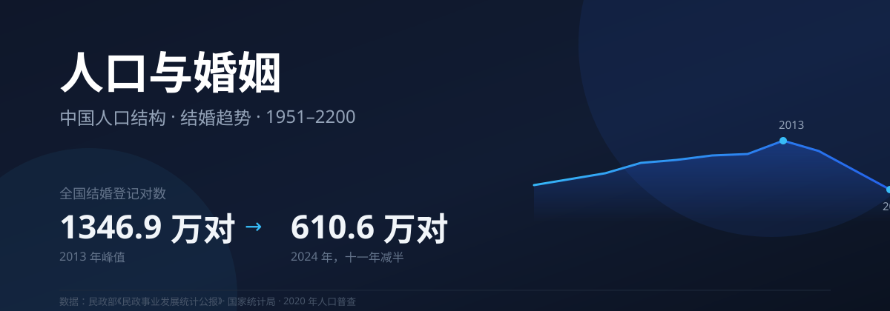

<p align="center">
  
</p>

<h3 align="center">中国结婚登记从 1346.9 万对跌到 610.6 万对，只用了十一年。</h3>
<p align="center">这个站把「结婚」和「人口」放在一起看 —— 一条从婚姻到养老的完整链条。</p>

<p align="center">
  <a href="https://dao1023.github.io/population/"></a>
  
  
</p>

<p align="center">
  
  
  
  
  
</p>

---

## 为什么把结婚和人口放在一起

因为它们是**同一条链**：

```
结婚（当年）
  └→ 出生（滞后约 1 年）
       └→ 幼儿园 / 小学（滞后 6 年）
            └→ 劳动力（滞后 20 年）
                 └→ 养老（滞后 60 年）
```

结婚登记是所有人口指标里**最靠前**的那个信号。等幼儿园招不满的时候再反应，已经晚了六年。

## 三个数字

| | 数值 | 说明 |
| --- | --- | --- |
| 峰值 | **1346.9 万对** | 2013 年，中国结婚登记的历史最高点 |
| 谷底 | **610.6 万对** | 2024 年，十一年跌 54.7% |
| 反弹 | **731.0 万对** | 2025 年，但增量集中在两个季度——是政策脉冲，不是趋势反转 |

少掉的 736 万对里，**只有 27% 是适婚人口变少了，73% 是「结婚这件事本身」变少了**。

## 站里有什么

### 首页 · 一篇报告

六个屏讲完一条线：从十一年腰斩，到「人少了还是不想结」，再到 2030 年的量级。图是定格的，能截图转发。

### 人口结构 · `/population`

- 年龄金字塔，1951–2200 可拖、可播放
- 可调参数：生育率覆盖、女性比例
- 总人口 / 中位年龄 / 养老抚养比
- 11 个消费热点（公寓、婚房、改善房、教育、医疗、养老……）随人群移动

### 结婚趋势 · `/marriage`

- 年度结婚 / 离婚对数，2000–2025
- 季度序列，2017Q1 起，标注政策与疫情节点
- 离结比折线
- 31 个省份，可筛选

## 本地跑起来

```bash
cd web
pnpm install
pnpm dev        # 开发
pnpm build      # 构建
```

数据转换（CSV → JSON）：

```bash
pnpm data
```

## 数据来源

| 数据 | 来源 | 说明 |
| --- | --- | --- |
| 结婚 / 离婚登记对数 | 民政部《民政事业发展统计公报》 | 季度与年度 |
| 分省婚姻登记 | 民政部 | 初婚 / 再婚为**人数**，1 对 = 2 人 |
| 年龄结构 | 国家统计局 · 2020 年人口普查 | 0–100 岁，逐年 |
| 年末总人口 | 《中国统计年鉴 2025》表 2-1 | 2000–2024；2025 为公报初步数 |
| 分年龄未婚比例 | 六普、七普长表（10% 抽样） | 2010 / 2020 两点，中间按年插值 |
| 生育率、死亡率 | 国家统计局 | 用于前向模拟 |

> 离结比一律按 **离婚对数 ÷ 结婚登记对数** 计算。表中若出现其他口径（如除以人数），数值会差一倍。
>
> 结婚率有四种口径，分子都是结婚登记对数，只换分母：总人口（官方粗结婚率）、20–39 岁、15–49 岁、15 岁以上未婚人口（国际口径 general marriage rate）。分年龄分母取自项目内模拟人口序列，早年总量偏小，早年的绝对值宜打折看；未婚分母在 2000–2009 与 2021–2025 为外推段。

## 目录结构

```
population/
├── data/                    # 原始 CSV
├── web/
│   ├── public/data/         # 转换后的 JSON
│   └── src/
│       ├── pages/           # 首页报告 / 人口结构 / 结婚趋势
│       ├── components/      # 图表组件
│       ├── composables/     # 人口模拟算法
│       └── lib/             # ECharts 注册、格式化
├── scripts/                 # 数据转换与校验
└── notebook/                # 预测 notebook
```

## 说明

人口数据为**情景推演**，不是预言。结婚与房价、消费之间的关系是统计相关，不构成因果。

数据以民政部、国家统计局公开发布为准。

---

<p align="center">
  <sub>如果这张图让你想起点什么，欢迎点个 ⭐</sub>
</p>
